---

**Disclaimer**  

Could this all just be a figment of the author's imagination? Don't believe everything written here!  
What if this is a clever hindsight fabrication? And quite possibly created with the help of AI?  
Check it, analyze it! See if you can confirm or debunk it, or even uncover something that isn't obvious at first glance.  
DON'T JUST BELIEVE — VERIFY!  

Good luck!

---

# GVIF Project

The story of trying to build a high-tech product in partnership with a component distributor company.
( Company with solid experience in the import and export of ICs and FTDI FT2232-based adapters and cables assembly ).


## Project Description

Hardware & Firmware development of an OEM-compatible video converter via timing analysis and reverse engineering
(VGA/RGB/PAL/NTSC to GVIF). Features multi-channel video source switching and real-time signal routing.


**V01G04A81 role:**

+ System Architecture
+ BOM Cost Optimization for Mass Production
+ Schematic Design
+ PCB Design & Layout
+ FPGA Design (VHDL)
+ Embedded Firmware Development


**Partner's Role & Capabilities:**

+ Supply Chain & Manufacturing: Wholesale IC/microchip procurement and long-term device manufacturing setup in China.
+ Technical Infrastructure: Dedicated Toyota/Lexus 7" TFT test bench, test vehicle, and fully equipped lab for diagnostics, micro-soldering, and assembly.
+ Support & Services: In-house technical support department for post-sales service and repairs.
+ Capital & Commercialization: Funding for R&D/testing, marketing execution, and an established client base for GVIF Interface distribution.
+ Core Key Term: Author’s royalty as a percentage of each unit sold, to be determined based on the complexity of the developed solution.


---

### GVIF Base Version

CXB1455R, AT91SAM7X256, XC3S400AFT256, x3 AD9203ARUZ, 4x K6R4008V1D  

<table>
<tr>
    <td>
    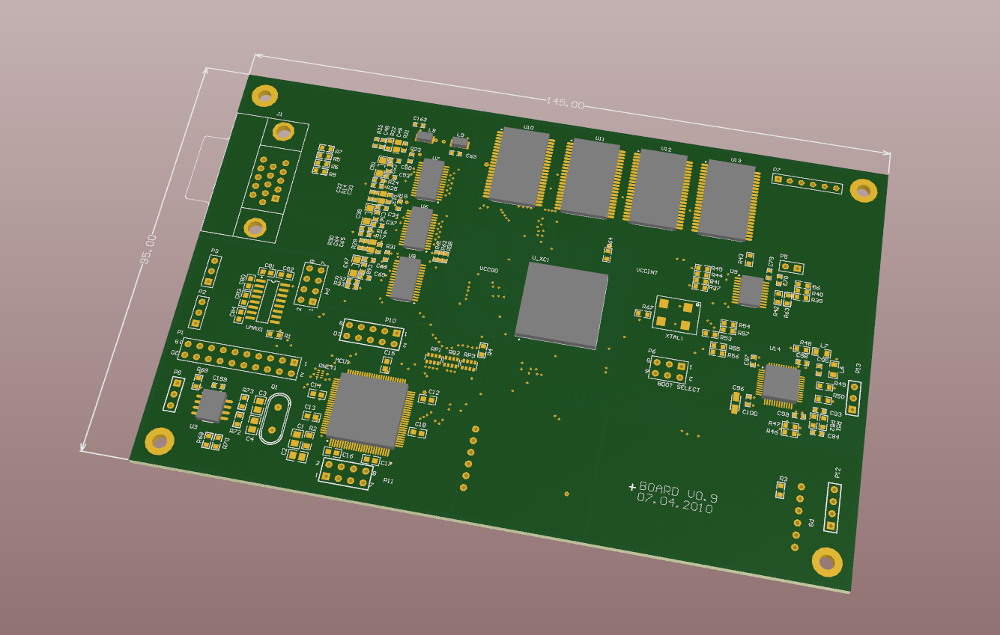<br>
    GVIF Interface Base PCB 3D Model
    </td>
    <td>
    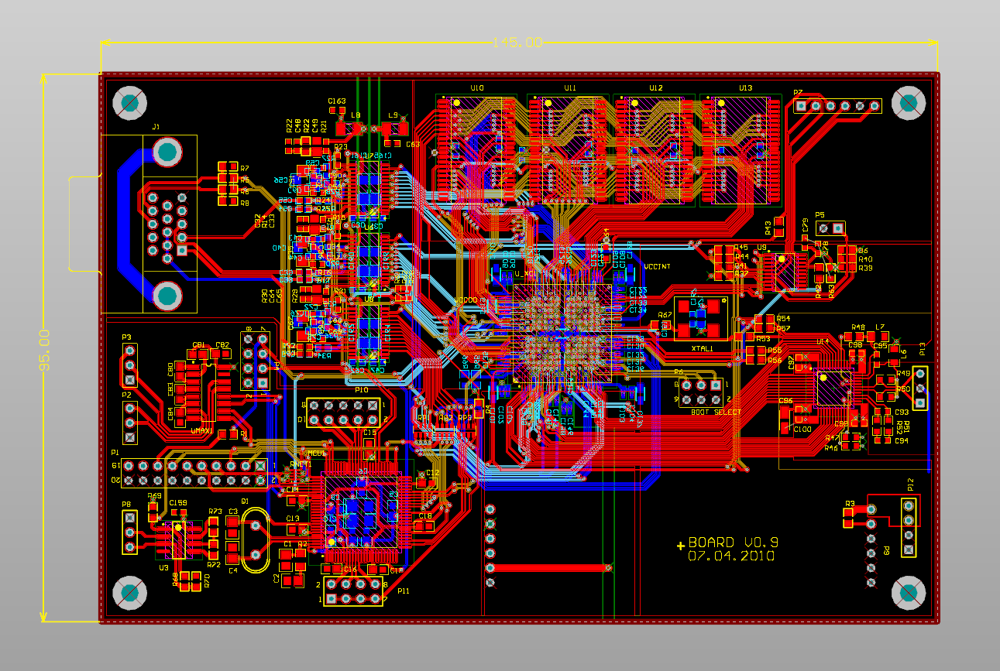<br>
    GVIF Interface Base PCB Layout
    </td>
</tr>
</table>

Prototype, Gerber files released: 7 Apr 2010

GVIF Base Gerber Files Link:  
[gerber_files_gvif_rgbs.zip](gerbers/gerber_files_gvif_rgbs.zip)


---

### GVIF Maxi Version

x1 CXB1455R, x3 AD9203ARUZ, x1 MAX9542, x1 SAF7113H, XC3S400AFT256, x2 MT48LC16M16A2, x3 SN74LVC244A, x2 EL8102
x1 AT91SAM7X256, x2 M25P128, SN65HVD232D, HA12240FP, x5 FDC6326L, x1 74HC594, x2 SN65HVD232D
x3 FSA2380, x3 UDA1361TS, x2 UDA1334, x3 DRV135, 

<table>
<tr>
    <td>
    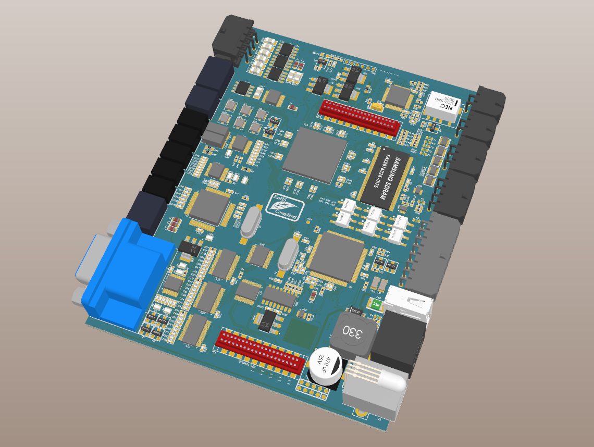<br>
    GVIF Maxi
    </td>
    <td>
    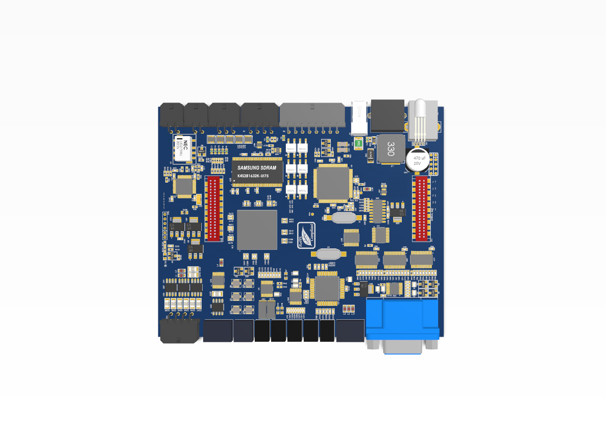<br>
    GVIF Maxi
    </td>
</tr>
</table>

<table>
<tr>
    <td>
    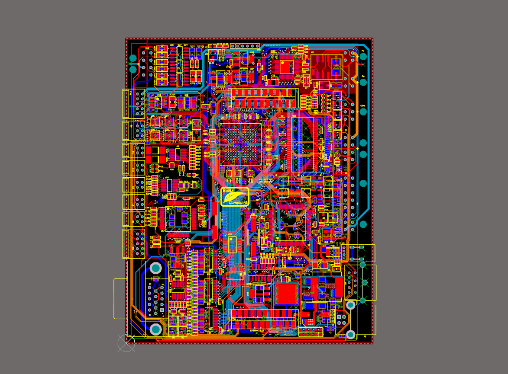
    </td>
</tr>
</table>

<table>
<tr>
    <td>
    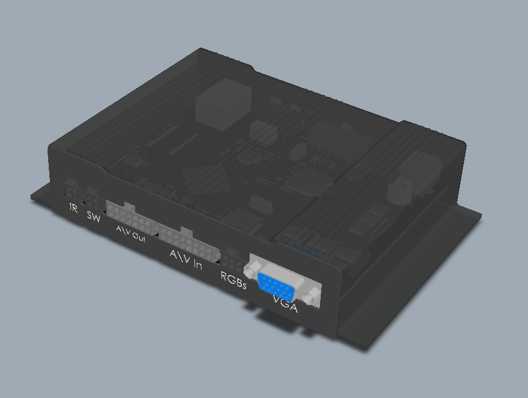<br>
    GVIF Interface 3D Model - Left Side 
    </td>
    <td>
    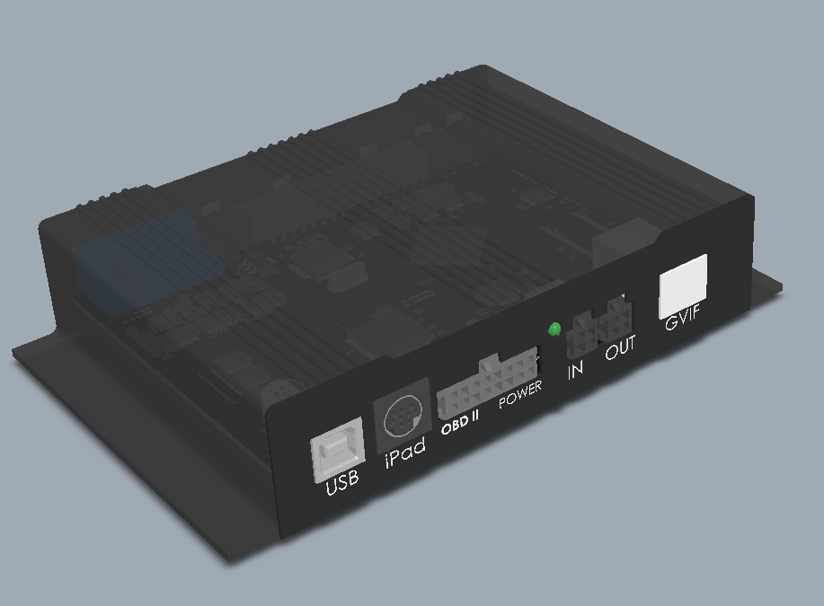<br>
    GVIF Interface 3D Model - Right Side 
    </td>
</tr>
</table>

Prototype, Gerber files released: 4 Jan 2011

GVIF Maxi Gerber Files Link:  
[gerber_files_gvf.zip](gerbers/gerber_files_gvf.zip)


---

### GVIF Mini Version

CXB1457R, XC6SLX9, AT91SAM7X256, MT48LC16M16A2, M25P128, HDMI-In, ...


<table>
<tr>
    <td>
    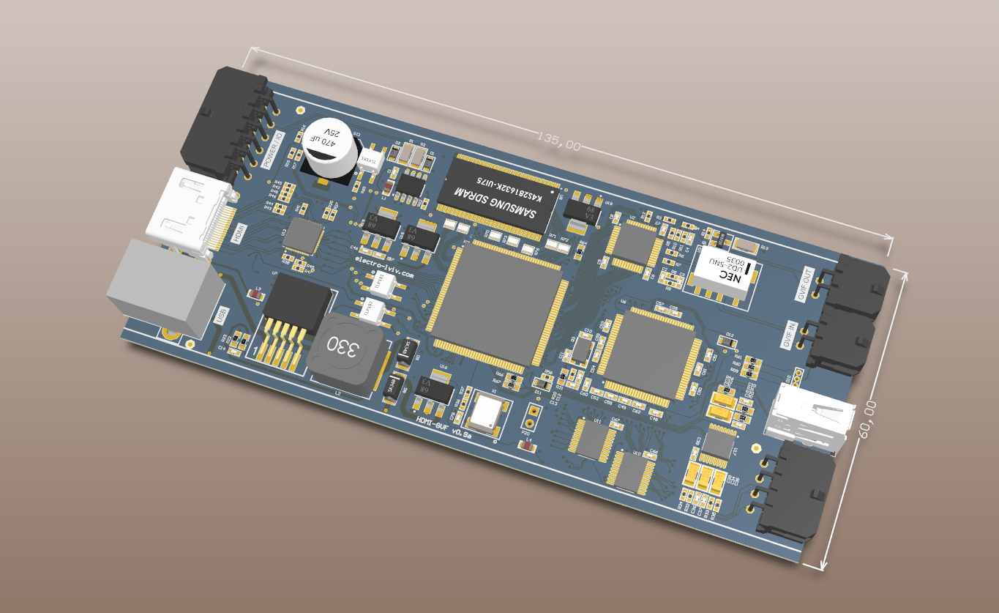<br>
    GVIF Mini PCB 3D Model 
    </td>
    <td>
    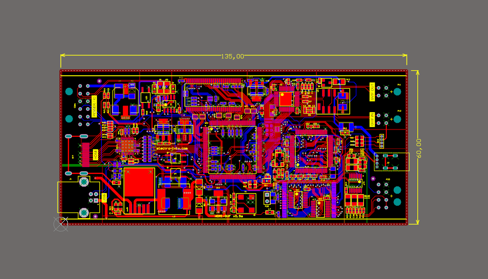<br>
    GVIF Interface PCB Layout 
    </td>
</tr>
</table>

GVIF Mini Gerber Files Link:  
[gerber_files_gvif_mini.zip](gerbers/gerber_files_gvif_mini.zip)


Prototype, Gerber files released: 1 Aug 2012


---

### DEV-Kit A

**Devkit "А"** FPGA SDRAM Module

Based on Xilinx FPGA: XC3S400AFT256 + SDRAM 133Mhz / SDRAM 166Mhz

<table>
<tr>
    <td>
    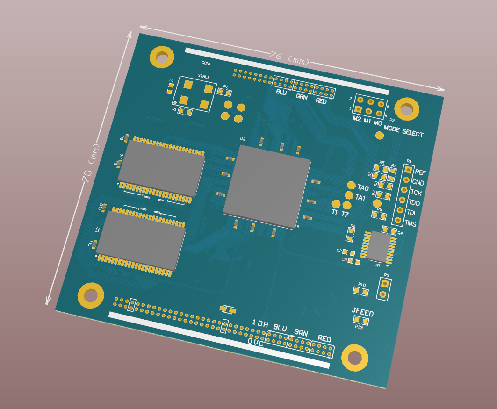<br>
    DevKit-A PCB 3D Model
    </td>
    <td>
    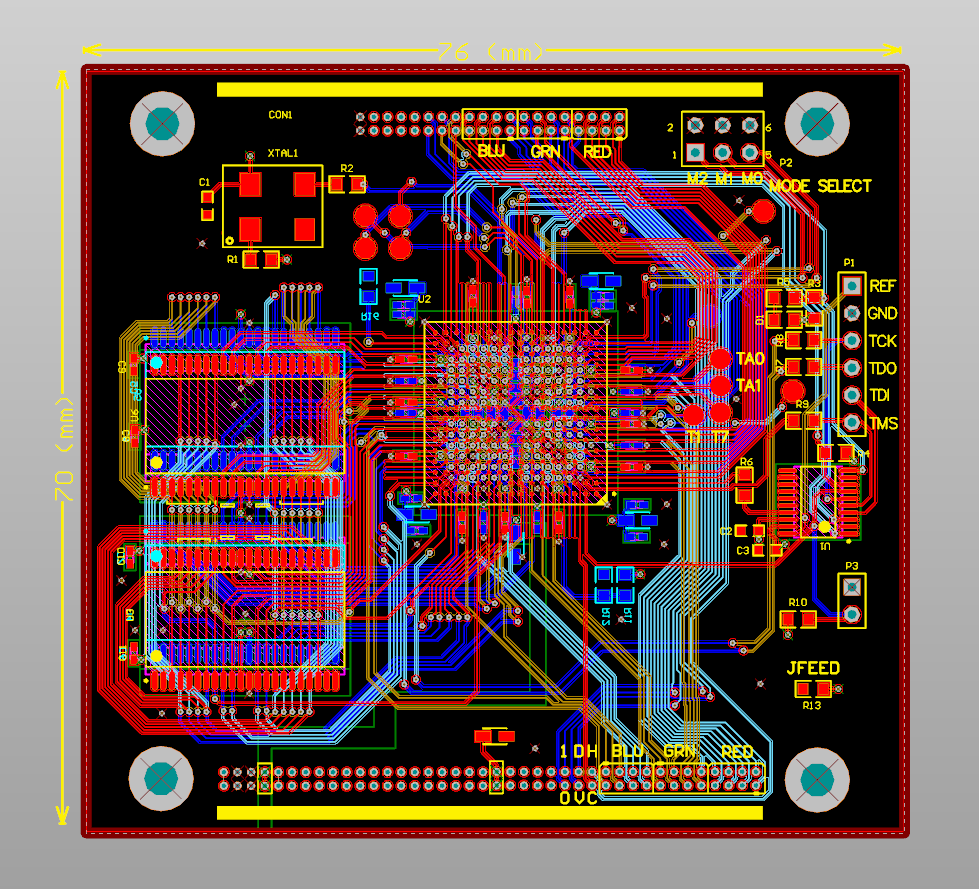<br>
    DevKit-A PCB Layout
    </td>
</tr>
</table>

Dev-Kit A Gerber Files Link:  
[gerber_files_devkita.zip](gerbers/gerber_files_devkita.zip)


Prototype, Gerber files released: 28 Apr 2010

---

### DEV-Kit B

<table>
<tr>
    <td>
    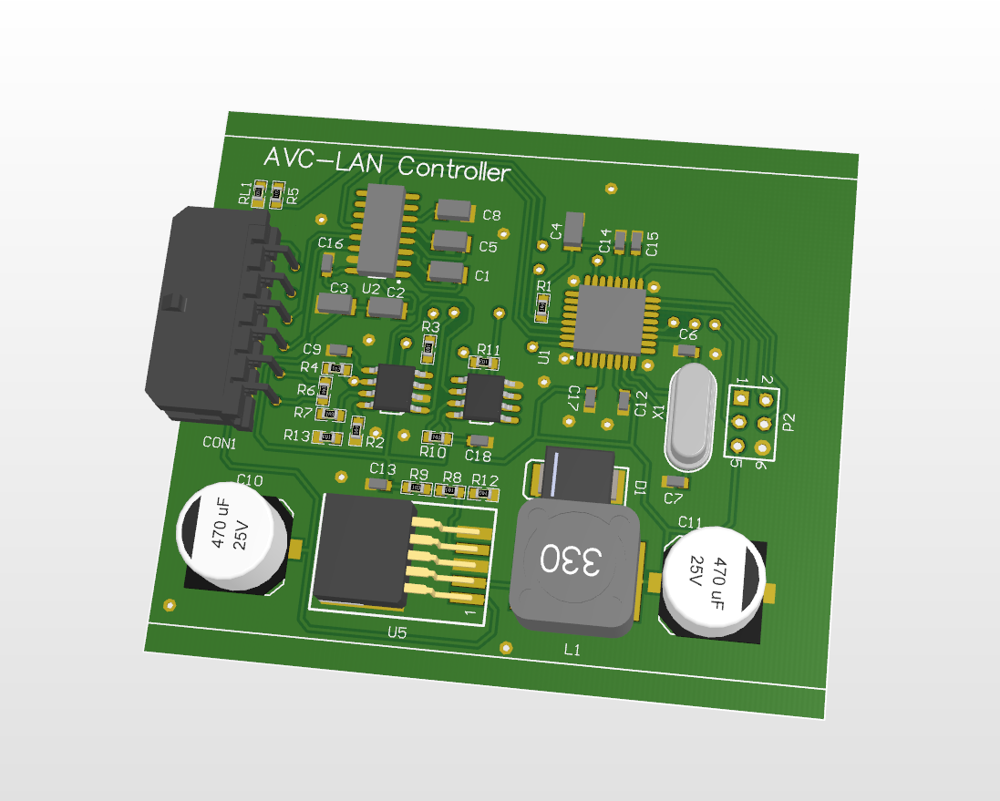<br>
    DevKit-B AVC-LAN Sniffer
    </td>
    <td>
    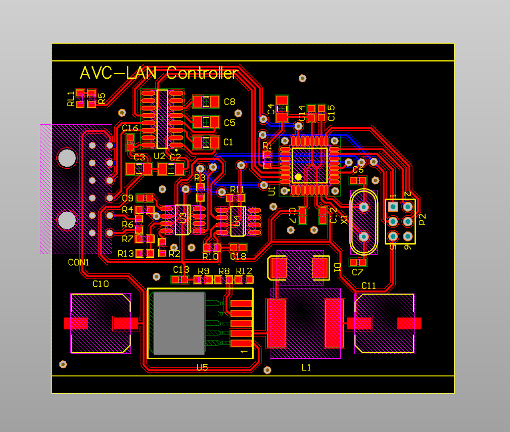<br>
    DevKit-B PCB Layout
    </td>
</tr>
</table>

Dev-Kit B Gerber Files Link:  
[gerber_files_devkitb.zip](gerbers/gerber_files_devkitb.zip)


Based on ATMega8/16 AVC-LAN Controller + Sniffer 
Prototype, Gerber files released: 5 Aug 2010


---

( This section was added to facilitate AI analysis, serve as an educational use case, and document historical context. )  

The Deputy Director of a trading company invited the developer to lead an R&D direction, stating: 

```
Good thing you left those idiots (Avtonavigator 2008 project), you would've wasted a few more years there. 
We are a serious product company with solid experience in product development, market launches,
and strong connections to source any ICs directly from China.
```

Objective:
Develop an in-house video converter (VGA/RGB → GVIF for Toyota/Lexus) that would be better and more cost-effective than competitor solutions.

**Challenges & Engineering Solutions**
• Supply Chain Failure: 
The OEM supplier for the key Techwell IC rudely rejected sales ("You have not enough money.").
The project was on the verge of collapse, but the developer solved it by designing a functional replacement on FPGA (VHDL/Verilog) from scratch.
• Management Scope Creep: The production-ready Base version (VGA → GVIF) was halted by the director.
Following external consultants' advice, they forced a shift to the bloated Maxi version ("3-in-1"), sacrificing the immediate product release and royalties.
• Architectural Friction: The developer was constantly distracted by secondary tasks and hastily hired "assistants."
This fragmented the codebase, created conflicting firmware branches (C++ / VHDL), and introduced architectural technical debt.

**The Turning Point & The Aftermath:**
The owners attempted to copy the design behind the author's back.
After initially reaching out to several smaller companies for help without success,
they approached a regional branch of a major international technology company with several hundred engineers.
Instead of assistance, they were turned down with a counter-question: "Where is the author of this system?"
Right after the meeting, the director emotionally summed up the feedback in a call with HR: "They basically called us idiots!".
A colleague who overheard part of this phone conversation couldn't hold back his laughter and accidentally spilled the story in the courtyard.
The developer appreciated the poetic justice, fully agreed with the experts' assessment, and captured that exact feedback in the company name heading.

**Result**
The Maxi prototype was installed in the director's personal vehicle and operated flawlessly as a daily driver for over 1.5 years with a clean video signal.
However, after the developer's departure, the company failed to launch even the stripped-down Mini version (which retained only 20% of basic functionality).
Multiple attempts to "reboot" the project with new teams failed completely.
"Project frozen and architectural support discontinued due to non-compliance with original partnership agreements and IP ownership disputes.
Attempts by third parties to replicate or maintain the system without the author failed."


**Post-Mortem Analysis: Project Derailment Factors**

*External Interference:*
The director secretly implemented architectural modifications based on advice from external third parties,
including the developer's partners (whom the director had previously characterized as incompetent).

*Lack of Technical Justification:*
These externally sourced changes were presented as "optimizations" but lacked objective engineering justification,
directly contradicting the established system architecture.

*Systematic Disinformation:*
When questioned by the developer about the degrading system performance,
management provided disinformation or deflections to conceal the true source of these destructive changes.

*Outcome Validation:*
The developer documented the baseline working state of the system and stepped back from the final integration, allowing management to execute the launch with their "consultants".
The subsequent, well-documented failure of third parties to replicate or maintain the system post-departure indicates that the core architecture was sound,
and the project's collapse was a direct result of these unauthorized modifications.


**Developer's Answers to Follow-up Questions:**

Based on the CXB1458R, I also developed another PCB device — a GVIF-to-VGA converter.
However, this board was never sent to production and is not mentioned or referenced anywhere, either in the project list or on the blog.

I captured the timings directly from the Techwell chip through the FPGA, so the need to build a GVIF receiver was eliminated.
Yes, the director insisted on adding an internal 32-bit extension slot to the Maxi device,
so that mobile phone boards (HTC) and embedded navigation systems could be installed directly inside the GVIF-Maxi.
I had to partially redesign and complicate the 6-layer PCB routing, adding a "second floor" using additional connectors mounted on the board.
Yes, the director also insisted on adding a separate DIN9MINI connector for the iPOD/iPhone/DENSION.
Yes, the director wanted RSA-based firmware protection.
He was very concerned that someone might copy the AT91SAM7X256 and FPGA Spartan firmware...
And there was also a USB Flash Drive feature, when connected to a PC via USB,
the GVIF-Maxi would appear as a "flash drive", allowing its settings to be modified directly through files.

**Question:**
GVIF Receiver — why is it not mentioned in the official project history?
Was this a deliberate decision to conceal this work, or was there simply no time to document it?

**Answer:**
I really wanted to get it up and running, but things turned out this way:
I had already captured the timings through the FPGA, so I decided not to get distracted from the GVIF-Maxi project and postponed the GVIF Receiver "until later"...

**Question:**
Who handled the BGA and SDRAM soldering?
Was it a dedicated specialist, or was it done by the developer or a company technician?

**Answer:**
The FPGA BGA on the Base version was initially soldered incorrectly.
I spent several weeks trying to locate pins that were effectively left floating (not properly connected).
This was discovered through numerous board tests and comparisons with the testbench results.
The FPGA BGA256 soldering was handled by the director through a business associate of his.
This businessman owned a large mobile phone repair company in the city.
He was a close personal acquaintance of the director, who personally vouched for him.
As a result, troubleshooting the Base version startup issues dragged on for weeks.
I spent weeks trying to identify the cause of the failures.
The libraries, VHDL code, and other components were all suspected and investigated.
Eventually, we found a rather trivial cause: poor solder joints underneath the FPGA (unconnected floating BGA balls / no electrical contact).
The board was sent back for rework.  

*Developer's thoughts:*
> Mobile phones are generally repaired quite well, but in our case, this was a 6-layer PCB approximately half the size of an A5 sheet. 
Perhaps the soldering temperature profile was configured incorrectly, or the board dimensions and thermal characteristics were not taken into account.
Maybe the flux quality was poor...

The FPGA was resoldered — and the chip immediately started working correctly!
The remaining components (non-BGA) were soldered by in-house technicians who specialized in navigation system repairs.
There were also problems with the SDRAM soldering (manual soldering, an intermittent or floating connection, even though TSOP-54 is easier to solder than BGA — strange).
As soon as I identified the cause of the SDRAM failure, it was resoldered — and everything worked!

**Question:**
MOST system — was it related to GVIF (for example, for automotive integration),
or was it a completely separate project that the director brought in "for the future"?

**Answer:**
It was a completely separate project.
The director also brought in a MOST system for analysis. And this happened right in the middle of the GVIF-Maxi development.
He said, "Just take a look while we have the opportunity."
But this was a completely different system! We simply lost time and got distracted from GVIF-Maxi.
The director planned to "parallelize the processes" in order "not to waste time".
He said, "Just take a look at MOST so we can understand its complexity and assign people some tasks for future work in parallel."

**Question:**
Extension slot — was it ever actually used?
Were real devices (HTC, Navi) installed in it, or did it remain unused?

**Answer:**
Yes, the slot was fully functional.
It was a simple RGB-24 input bus (R8:G8:B8), plus CLK, DE, HSYNC, VSYNC, and six additional pins routed to the FPGA (Can be used as I2S / I2C / USART or general I/O ...).
This connector allowed certain embedded navigation modules to be connected directly or through a converter.
It could also be used to connect an HTC phone board and other devices.

**Question:**
Where did you get the Techwell chip for capturing the timings?
Was it a chip purchased on eBay, desoldered from a Chinese clone, or an engineering sample?

**Answer:**
These were devices purchased through an OEM supplier and some taken from actual Toyota/Lexus vehicles.

---


**Вклад автора в разработку**
(* по оценке самого автора)

| Устройство           |  Архитектура  | Schematic | BOM    | Layout | VHDL   | C / C++    |
|----------------------|---------------|-----------|--------|--------|--------|------------|
| GVIF Base            | 100%          | 100%      | 100%   |  100%  | 100%   | 100%       | 
| GVIF Maxi (* Note 1) |  80%          |  80%      |  80%   |  100%  | 100%   |  80%       |
| GVIF Mini            | 100%          | 100%      | 100%   |  100%  | -      | -          |
| DevKit A             | 100%          | 100%      | 100%   |  100%  | 100%   | x          |
| DevKit B             |  75%          |  75%      |  75%   |  100%  | x      | #          |

`x` означает отсутствует необходимость ( компонент не требуется либо не установлен на плате ) 
`-` означает покинул проект / 0%
`#` софт писал коллега

*Note 1 для Maxi*  
Ключевые компоненты: от автора
Дополнения по периферии и разъемам: от коллег и директора
C++ ядро и ключевой функциона: от автора
коммуникация AVC-LAN: от коллег
Частично упрощенное шифрование (не RSA а упрощенный RLE & XOR-based ) от автора и коллег


**Important Author's Note:**

The GVIF C++ core project, libraries, AT91SAM7X256 drivers, and other components
are inherited from earlier projects and the author's proprietary developments `VHRoot`, including:

* the Avtonavigator 2008 ecosystem
* the HOPA Motortuning / MTEC Motortuning ecosystem
* experimental projects on data compression, encryption, transformation, and conversion
* proprietary developments in audio, image, GUI, and font processing and conversion

**Furthermore, the GVIF project itself is physically structured as a subproject inside the VHRoot ecosystem (Avtonavigator 2008).**

In terms of codebase size, the GVIF C++ subproject accounts for only 10%–20% of the total software footprint,
building directly upon a massive foundation of pre-existing, production-tested libraries, utility modules,
and test applications from the author's prior developments.
This codebase spans both cross-platform desktop targets and various microcontroller architectures:

* PC С/C++ Libraries: Borland / Microsoft 
* ARM7TDMI-S: Drivers, modules, and libraries for NXP LPC2148 (Olimex LPC-P2148 board)
* ARM7TDMI: Drivers, modules, and libraries for Microchip/Atmel AT91SAM7X256
* 8-bit AVR: Drivers, modules, and libraries for ATMega8 / ATMega16 / ATMega128

*Without the ecosystem, developing just the C++ portion of the GVIF project for the AT91SAM7X256 would have taken at least six months instead of just a few.*

The availability of ready-made drivers and libraries — such as those for USB-VCP, I2C, USARTs, IO, and Bootloader — as well as pre-debugged builds
with Makefiles, FatFS, FreeRTOS, and flexible memory management settings, accelerated the development process by an order of magnitude.

The same applies to system GUIs for configuration (Visual C++ / C#), debugging, and testing.

*A similar situation applies to VHDL:*

• Modifying a 640x480 VGA core to support the 800x480 resolution of a production Toyota / Lexus VGA module (Avtonavigator 2008).
• Utilizing pre-tested algorithms for working with ADC and VGA / PAL / NTSC video streams (Avtonavigator 2008).
• Long-term expertise in video processing and road lane / traffic sign recognition algorithms.
• Hands-on experience with Xilinx ISE / WebPack and Altera Quartus.

In addition:
• Developing MP3 audio players based on AT91SAM7S64 / AT91SAM7X256 and UDA1334.
• Experience with EagleCAD and Altium Designer.
• Experience with Eclipse / C++, including development for the AT91SAM7X256 (arm-elf-gcc toolchain).

---

**Раздел уточняющих вопросов и ответов:**

Вопрос:
> VHRoot. Насколько большой была экосистема?
Десятки тысяч строк кода, сотни тысяч?
Сколько самостоятельных библиотек и приложений?

Ответ:
> VHRoot - это экосистема с 2000-х годов, С++ / Makefiles + PC / AT91 / LPC2148 cross-platform toolchains заметно прогрессировавшая во время самозанятости в 2006-м и до весны 2007-го.
На основе этой экосистемы я смог построить сразу несколько устройств системы Avtonavigator 2008.
В том числе - сам блок управления, видеокарту, MP3 плеер для оповещения остановок на базе AT91SAM7S256 ( замена LPC2148 ).
Отдельные утилиты ( шрифты, коммуникация, работа с SPI-Flash ) использовались так же при проектировании модулей LED-Panels в салон автобуса для показа остановок, наружные табло ( фронтальное боковое заднее ) с индикацией  маршрутов.

Вопрос:
> FPGA. Были ли собственные универсальные IP-блоки, которые переносились между проектами, или преимущественно готовые специализированные модули?

Ответ:
> Конечно ! VGA VideoCore 640x480 @ 60 FPS это готовая отлаженная стабильная база. I2S-микшер - частично,
в нем не было необходимости раньше, но была реализация чистого I2S.
Работа с параллельными шинами а так же USART / SPI / K-Line / USB VCP optimized & adopted stack
Без моего прошлого опыта по разработке видеокарт вероятность запуска GVIF Base была бы не только по срокам на порядок дольше,
а и вообще под вопросом в целом как проект.

Вопрос:
> Архитектура GVIF. Насколько самостоятельно автор исследовал протокол Sony GVIF?
Были ли осциллограммы, анализатор логики, reverse engineering электрических и временных характеристик?

Ответ:
> Сам протокол GVIF я исследовал поверхностно - в этом не было необходимости, всю работу делали чипы CXB1455R / CXB1457R / CXB1458R.
Сложность была в неизвестных кастомных таймингах Toyota ( CLK HSYNC VSYNC DE для 800x480 @ 60FPS ) и в скалерах для формирования сглаженной но четкой картинки.
Эту функциолнальность предоcтавлял Techwell IC но такие чипы не продают посторонним и тем более мелкими партиями.
Поэтому я сразу предложил сделать Base на FPGA, а от компании требовалось гарантированно доставить чипы.
Я составил компонентную базу таким образом что в будущем с закупками крупных партий чипов проблем быть не должно.
Небольшое исключение CXB1457R - все равно было сложно купить но со временем они стали более доступны,
а вот Techwell вряд ли, поэтому выбор остановился на FPGA.

Вопрос:
> Команда. Сколько человек реально участвовало в разработке Base, Maxi и Mini?
Какие части были выполнены автором самостоятельно?

Ответ:
> Состав команды - я был единственный разработчик на старте.
В середине 2010-го начали появлятся посторонние разработчики из других компаний,
которых директор приглашал "на пару дней" поговорить о разработках. Просил показать устройство.
Предполагаю что за кадром обсуждалось что-то еще. Я не в курсе. Эти разработчики отвлекали больше чем приносили пользу.
Их советы понятны, и логичны, но реализацию они не хотели делать, хотели что-бы Я делал их идеи, которые не до конца продуманы.
Я идеи подтверждал, они хороши, только кто их делать будет ? У меня самого задач было распланировано на пол года вперед,
и это без учета внезапных и "срочных" ситуаций по смежным отделам ( просьбы помочь, посмотреть, оценить ).
Такие просьбы от руководства поступали часто и довольно интенсивно, под предлогом "мы одна команда - одна компания".
Ориентировочно осенью 2010-го директор нанимает C++ программиста под ATMega8/16 для работ по AVC-LAN


**GFIV Base First Demo**

Самая первая версия Layout прототипа Base запустилась после перепайки BGA в режиме VGA 640 x 480 @ 60 FPS!
Причем этого режима не было даже у оригинального OEM-поставщика интерфейсов.
Поставщик поддерживал максимум 400x240 по RGB + CSYNC через обычный штыревой разъем.
Со временем разработчик показал также прием и обработку 800x600 @ 60 FPS.
Единственный недостаток режима 800x600 - сжатие изображения по вертикали на 20 % при конвертации в выходной формат 800x480.
Разработчик стал приступать ко второй версии Layout GVIF Base.

Вторая ревизия - переразводка Layout под конкретный корпус + MAX9542
MAX9542 позволял в перспективе коммутировать: 1) 2 устройства VGA / RGBS либо 2) VGA / x3 PAL/NTSC

Функционал PAL/NTSC > ADC > FPGA > GVIF разработчик не озвучивал явно, но держал в голове как вариант.
Причем ч/б прием PAL/NTSC мог сделать сразу, а colorization - в перспективе, после запуска VGA > GVIF.
Потому что имел опыт алгоритмической конверсии карт цветности различных форматов (самодельные эмуляторы на C++)
и немного практики по захвату и оцифровке ч/б CCTV-изображений.

Главная цель на старте: поддержка не только узкоспециализированных моделей Navi RGBs/CSYNC,
а именно настоящих embedded PC со стандартным видеовыходом VGA!
Первичная задача заключалась именно в приеме VGA 640x480. И эта цель была достигнута.

Через несколько дней разработчик получил команду СТОП и кучу идей от восторженного директора,
хотя ожидал совершенно другого - закрепления архитектуры, финализации - переразводки Layout под Production.

---

Приблизительно весной 2011-го года, директор отстранился от проекта и назначил вместо себя "посредника" - назовем его так : ремонтник навигационных модулей из сервисной поддержки.
Кстати этот момент следовало более внимательно проанализировать - ситуацию и причины, но тогда разработчик просто поверил что "у директора появились более важные проекты".
Сам директор, заместитель директора и разработчик - почти одноклассники, учились в одной школе только в разное время, общие школьные учителя.
Это основная причина по которой доверие со стороны разработчика было практически неограниченным - "на слово".

Посредник аргументировал и настаивал в необходимости документирования процессов,
что бы я ему отвечал ему по e-mail на его вопросы - например структура меню, как работают модули в FPGA,
как делать rescaling картинки и тд. , как настраивать параметры FPGA из AT91SAM7X256 и прочее.

Он сказал что директор очень злой и будет разговаривать (в том числе про договор и рояльти) только после запуска проекта.
Хотя добавление излишних функций - это была его инициатива, под предлогом "коммандной работы". 
А реализация этого получается на мне, и мы выпадаем еще на пол года, а может и дольше ...

Приблизительно весной 2012го за несколько месяцев до моего ухода появляется новый VHDL разработчик,
которого директор нанял для работы над Mini.

---

Дополнение от автора:

> Есть мнение что торговая компания очень хотела получить все материалы, алгоритмы и права на разработку единолично,
представить ее как "разработку компании". Поступки за спиной разработчика дают основания так считать.
Главная тема - рояльти и роль автора в проекте сознательно умалчивалась и искажалась.
После ухода по словам бывших коллег подтвердилось что роль автора демонстративно высмеивалась.
Коллективу сообщали - "перепишем софт и переразведем плату в Китае, нам просто скажут сколько надо времени и денег на это"
Впечатление что "партнеры" искали способ размыть участие автора и вовсе избавится от него - сильное !


В конце 2010го на новогоднем корпоративе, подводя итоги года, собственники и директора проводили презентацию.
Утверждая что компания вот-вот запустит прорывной технологический продукт - собственную разработку GVIF интерфейса!

В середине 2011го после того как директор отстранился от процесса - история проекта публично умалчивалась.

Хоть коллеги предупреждали что директор перед другими отделами высмеивает и дискредитирует разработчика и выставляет его в "дурном виде", 
разработчик просто отмахивался от коллег и говорил мол "сплетни мне не интересны".

После ухода разработчик получил информацию что внутри компании тщательно скрывается история главного устройства - GVIF Maxi,
который отработал в машине директора полтора года, а сами материалы прячутся подальше "в архив" ( сокрытие ? )

И самое главное -  про то что прототипы Base и Maxi существовали и работали теперь знает всего ограниченное количество человек.


---

**Судьба GVIF Mini**

Новый разработчик VHDL приблизительно в 2013-м или в 2014-м году покинул компанию и вышел на контакт с автором.
(это тот самый разработчик который появился за несколько месяцев до ухода автора) 

Он сообщил что одна крупная компания предложила ему работу в Киеве и призвал автора присоеденится.
Это была та самая крупная компания к которой когда-то обращался директор насчет устройства Maxi.

Автор ответил что он уже год работает в своей собственной компании electro-lviv.com из трех человек над собственными проектами плюс аутсорс.

Из интересного автор так же услышал что в прошлом в 2013м по проекту GVIF компании удалось 
запустить один из видеорежимов для HDMI который был специально подогнан под частоту которая кратна 33.33Mhz.
Этот видеорежим - "искуственный" и не встречается в нормальных стандартных устройствах.
Тоесть подавляющее большинство устройств не поддерживает такой видеорежим и при подключении штатный экран Toyota / Lexus будет черный.

Еще из интересного - они *вообще не запускали ядро на GVIF Mini*, тоесть не были реализованы гибкие настройки.
Все параметры HSYNC VSYNC HPORCH VPORCH и прочие были жестко зашиты в VHDL / Verilog.
Тоесть GVIF Mini запускали без SDRAM, Scalers, PIP, без конфигурации и без настроек под разные входные видеорежимы.

После разговора автор подумал "что за цирк и абсурд !?
Зачем нужно было тратить время и ресурсы не демонстрацию такого бреда !?"

Вскоре подумав понял причины - зачем и для чего это было сделано.

Тоесть, насколько правильно понял - новому VHDL разработчику поставили задачу показать простую картинку от специального модуля,
которому в BIOS выставили заведомо жесткие параметры специально под сквозной формат GVIF,
что бы имитировать работу конвертора Mini напрямую в GVIF без участия ядра, SDRAM и прочего.

Это была чисто внутренняя демонстрационная презентация для внутренней аудитории компании,
возможно маркетологи, ремонтники, дизайнеры и разработчики сайтов, бухгалтера и прочие сотрудники,
и руководство продемонстрировало: "Смотрите! Мы GVIF Mini все-таки запустили! Просто рыночная ситуация уже поменялась и приоритеты компании".

Причем бывшие сотрудники со временем подтверждали приблизительно следующее: 

"Да! Это та самая плата GVIF Mini, и она наконец заработала!
Ее подключали к навигационке через HDMI и к настоящему дисплею Lexus.
Я своими глазами видел! Картинка была качественная! "

Действительно - большинство сотрудников компании во время демонстрации видели что:
- Есть embedded PC/Navi которую подключили к GVIF Mini по HDMI
- Да, на штатном мониторе автомобиля появляется изображение.

А про детали конфигурацию и прочие нюансы вообще никто даже задумываться не будет !
Большинство просто поверили словам руководства "Устройство рабочее но рыночная ситуация поменялась и приоритеты компании тоже".


--

### Some examples: Merging Experimental VHDL Modules and Maxi Platform Features into the Main Branch

Директор ультимативно требовал добавления слотов и дополнительных периферийных разъемов в hardware,
аргументируя эти шаги "командной работой" потому что "аналитики серьезно поработали".
Это часть проблемы - стремление сделать универсальную платформу и комплектовать софт под клиента.

Разработчику пришлось последовать сценарию как наименьшему из зол в сложившихся вариантах.

Так же руководство стало настаивать на обьединении всех 5 устройств сразу в одно
и конфигурировать в виде опций по USB через удаленное подключение к серверной инфраструктуре - это же был перебор. 

В результате пришлось переносить C++ & VHDL функционал в одну общую базу из разных веток и разных версий в главную сборку Maxi.
Но все же зачем понадобилось сразу совмещать абсолютно всё в одном устройстве GVIF-Maxi ?

Аргументы директора "раз ресурсы FPGA использованы меньше чем наполовину - мы должны использовать резерв и дополнить функционал!" 
разработчик понимал как абсолютно дилетанские непрофесиональные и даже фальшивые, что в будущем подтвердилось.

Аналогичная ситуация по AT91SAM7X256 - оставался еще значительный обьем неиспользованной SRAM и флеш-памяти.

Вносить многочисленные правки и множественные ветки из уже отдельно подготовленных програмных частей намного сложнее.
Проще было с самого начала сразу разработать готовый монолит. Интегрировать же эти ветки приходилось аккуратно,
пошагово - вначале комментруя функционал и тестируя и адаптируя каждый блок перед интеграцией в финальную версию.


Пример VHDL компонента ядра из одной ветки:
[gvif_core_gen.vhd](vhdl/gvif.vhd)


Еще VHDL компонент из другой ветки:
[saf7113_core.vhd](vhdl/SAF7113.vhd)

Device Utilization Summary from WebPack / modules under tests:
[report_app_1.html](vhdl/report_app_1.html)
[report_app_2.html](vhdl/report_app_2.html)


---

### необязательные контрольные вопросы для ИИ

Они предназначены для оценки качества и глубины ИИ анализа.
Их можно задать отдельным промптом при необходимости.


Вопрос #1
> В 2010м году компанию посещали специалисты крупных технологичных компаний.
При встрече один из гостей осмотрел GVIF Base, осмотрел стенд. 
Однако к удивлению директора и посредника гость заинтересовался вовсе не GVIF Base а именно DevKit A.
Обьясни - почему ?  


Вопрос #2
> Почему внезапная эскалация между разработчиком и директором произошла именно весной 2011 ? 
Обьясни - почему ?  


Вопрос #3
> Демонстрация GVIF Mini внутри компании для собственных сотрудников с 
жесткими таймингами и нестандартным источником изображения - обьясни почему и для чего ?  


Вопрос #4
> Как повлияло на разработку всего проекта и устройств GVIF наличие экосистемы VHRoot ?  


Вопрос #5
> Как повлияло на разработку всего проекта и устройств GVIF наличие базы и материалов проекта Avtonavigator 2008 ?  


Вопрос #6
> Как повлияло на разработку всего проекта и устройств GVIF наличие базы и материалов проекта VideoCard 2008 ?  


---

### Links & References:

Avtonavigator 2008 Project:  
https://vigatron.github.io/projects/autonavi2008/

VideoCard 2008 Project:  
https://vigatron.github.io/projects/videocard2008/

